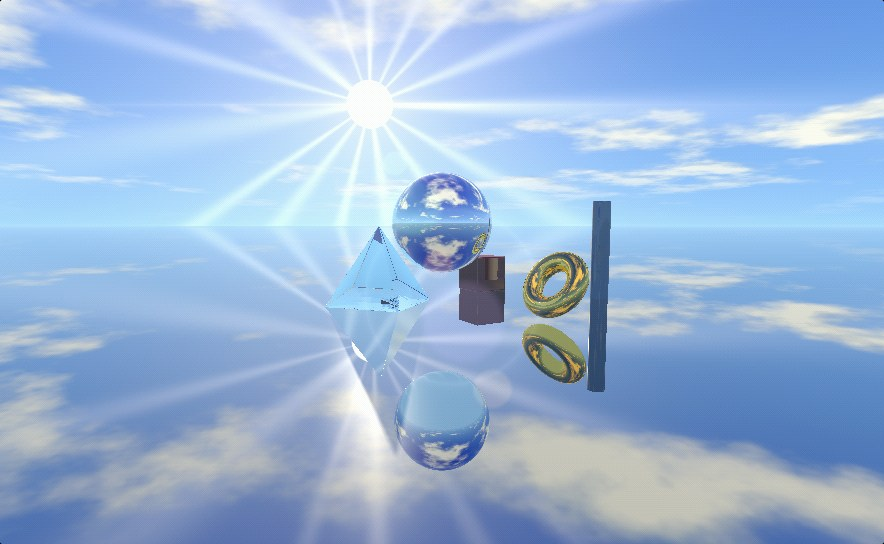

# Dreamscape 97

Make late-90s CGI landscapes in your browser: chrome spheres over the sea, giant ringed planets, lava plains, glowing orbs and mirror floors, all with that hard-shadowed, oversaturated look of 90s CD-ROM art and metal album covers.

**[Open it live →](https://alex4nder1998.github.io/dreamscape-97/)**: works on desktop and phone, nothing to install.

  
  

## What you can do

- **Create:** drop in terrain, floating islands, spheres, cubes, cylinders, cones, pyramids and rings (up to 10 objects). Pick a checker, sand, grass, rock, mirror or lava ground, or wavy or calm water.
- **Edit:** tap an object to select it, drag to move it, and set its size, height, lift, turn and tilt. Materials: chrome, glass, gold, red, blue, marble, rock, checker, mountain, white, glow and ice. *Row* repeats an object into the distance.
- **Sky & Fog:** 10 skies with giant planets, moons, stars, light rays and lens flare. Drag the sun on the dial and set clouds, haze, fog and rays. The *90s look* switch toggles hard shadows, clipped colour and a 16-bit dither.
- **Scenes:** 14 ready-made worlds to start from.
- **Render** draws the full-quality picture strip by strip, **Save** gives you a JPEG, and **Fly** orbits the camera live.

## Share your world

- **🔗 Share** (Scenes tab, or after saving a render) copies a link that contains the whole world. Anyone who opens it gets your exact scene and can remix it.
- **⬆ Submit** opens a ready-filled [gallery issue](https://github.com/alex4nder1998/dreamscape-97/issues/new?template=gallery.yml) (needs a GitHub account). Name your world in the title and press Create.
- Worlds that get the `featured` label appear in the app's Scenes tab for everyone, after the line, credited to the person who submitted them.

## How it works

It's one self-contained `index.html`, with no build step and no dependencies apart from two Google Fonts. The whole scene is a WebGL 2 fragment shader that ray-marches signed distance fields. Terrain is analytic fBm noise, and it has reflections, refraction through glass, soft or hard shadows, a procedural cloud layer and sky planets with rings. A rough preview shows while you edit, and the full render fills in over a few frames so phones stay responsive.

To run it locally, open `index.html` in a browser, or serve the folder (`python3 -m http.server`).

Needs a browser with WebGL 2 (any recent Chrome, Edge, Firefox or Safari).

## Contributing

New scenes, shapes, materials, skies and bug fixes are all welcome. See [CONTRIBUTING.md](CONTRIBUTING.md) for how the code is laid out and what a good pull request looks like.

## Credits

Inspired by the look of 90s landscape renderers and the album art people made with them. It's not affiliated with or endorsed by any of them. All code here is original.

## License

[MIT](LICENSE)
