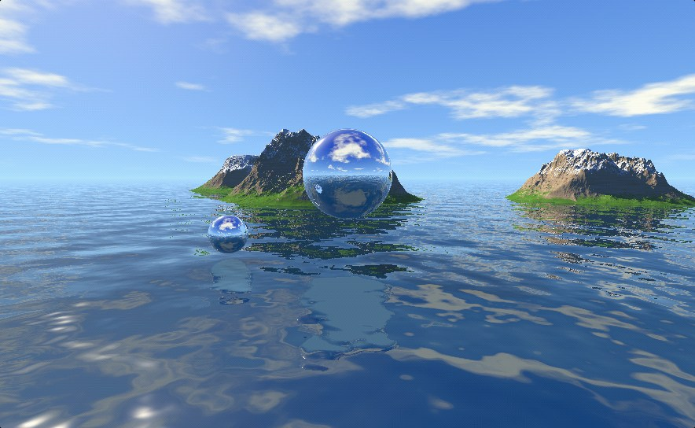
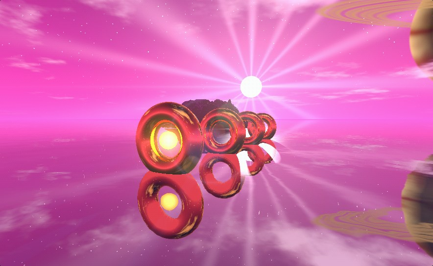
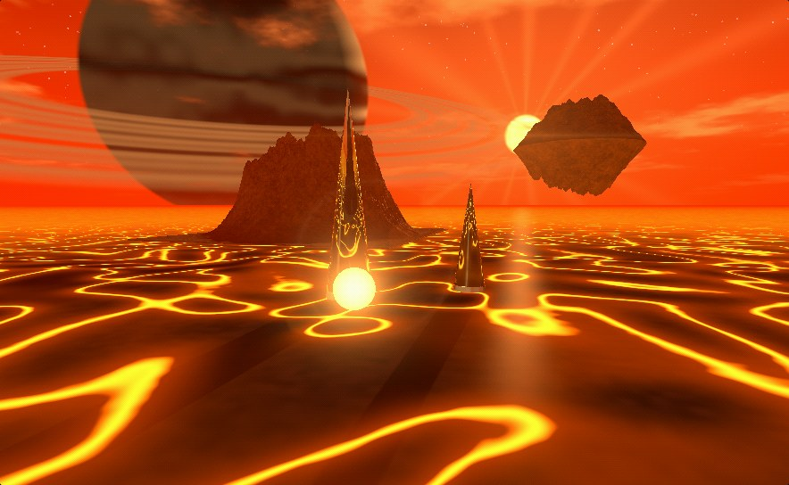
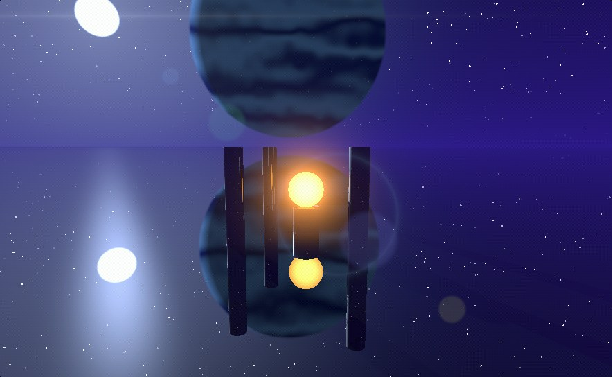
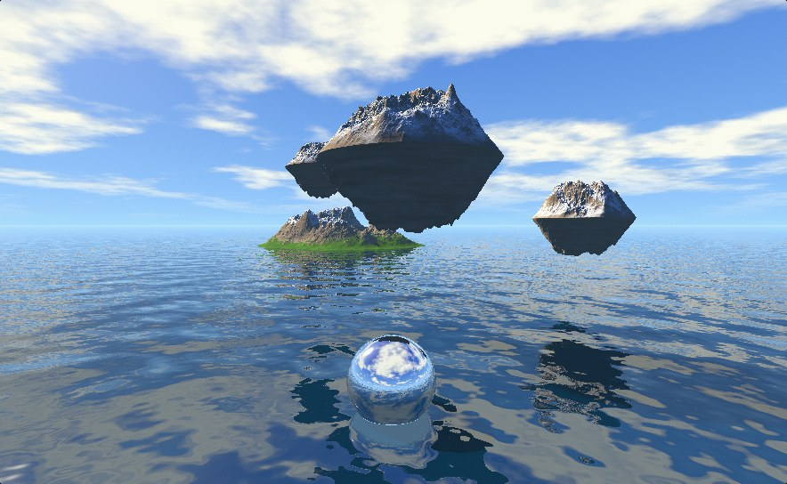

# Dreamscape 97

Make late-90s CGI landscapes in your browser: chrome spheres over the sea, giant ringed planets, lava plains, glowing orbs and mirror floors, all with that hard-shadowed, oversaturated look of 90s CD-ROM art and metal album covers.

Works on desktop and phone, nothing to install. **[Open it live →](https://alex4nder1998.github.io/dreamscape-97/)**

  
  

## What you can do

- **Create:** drop in terrain, floating islands, spheres, cubes, cylinders, cones, pyramids, rings, arches, stairs, twisted pillars, crystal clusters and columns (up to 10 objects). Pick a checker, sand, grass, rock, mirror or lava ground, or wavy or calm water.
- **Edit:** tap an object to select it, drag to move it, and set its size, height, lift, turn and tilt. Materials: chrome, glass, gold, red, blue, marble, rock, checker, mountain, white, glow and ice. *Row* repeats an object into the distance.
- **Sky & Fog:** 10 skies with giant planets, moons, stars, light rays and lens flare. Drag the sun on the dial and set clouds, haze, fog and rays. The *90s look* switch toggles hard shadows, clipped colour and a 16-bit dither.
- **Scenes:** 14 ready-made worlds to start from, plus community worlds featured from the gallery.
- **Cover:** turn your world into a 90s album cover. Band name and album title in chrome, fire, ice or gold lettering, and 🎲 makes up names for you. Press **1:1** for a square frame.
- **Render** happens by itself when you stop editing (switch *Auto* off to do it by hand).
- **Save** as shown on screen, as a smooth 2K poster or as a 4K print.
- **● Clip** renders an 8-second fly-through video at full quality, frame by frame.
- **⛶** hides everything but the picture. **Undo/redo** and **autosave** mean nothing gets lost.
- **Install it** from your browser's menu (*Add to Home Screen* / *Install app*) and it works offline.

### Keyboard (desktop)

| Key | Does |
|---|---|
| R | Render |
| A | Auto render on/off |
| S | Square 1:1 frame |
| F | Full screen (Esc to leave) |
| V | Record a clip (again to stop) |
| Arrows | Move the selected object (Shift for bigger steps) |
| Delete | Delete the selected object |
| Cmd/Ctrl+Z, Shift+Cmd/Ctrl+Z | Undo, redo |

## Share your world

- **🔗 Share** (Scenes tab, or after saving a render) makes a picture of your world and sends it together with a link that contains the whole world. On a phone it opens the share sheet with both attached; on a computer **Copy picture + link** puts both on the clipboard. Chats show your actual scene. A shared link opens **view only**, as a full-screen picture; **✎ Edit a copy** turns it into your own world to change, and the original link stays as it was.
- **⬆ Submit** opens a ready-filled [gallery issue](https://github.com/alex4nder1998/dreamscape-97/issues/new?template=gallery.yml) (needs a GitHub account). Name your world in the title and press Create.
- Worlds that get the `featured` label appear in the app's Scenes tab for everyone, after the line, credited to the person who submitted them.

## How it works

It's one self-contained `index.html`, with no build step and no dependencies apart from two Google Fonts. The whole scene is a WebGL 2 fragment shader that ray-marches signed distance fields. Terrain is analytic fBm noise, and it has reflections, refraction through glass, soft or hard shadows, a procedural cloud layer and sky planets with rings. A rough preview shows while you edit, and the full render fills in over a few frames so phones stay responsive.

To run it locally, open `index.html` in a browser, or serve the folder (`python3 -m http.server`).

Needs a browser with WebGL 2 (any recent Chrome, Edge, Firefox or Safari).

## Contributing

New scenes, shapes, materials, skies and bug fixes are all welcome. See [CONTRIBUTING.md](CONTRIBUTING.md) for how the code is laid out and what a good pull request looks like.

## Credits

Inspired by the look of 90s landscape renderers and the album art people made with them. It's not affiliated with or endorsed by any of them. All code here is original.

## License

[MIT](LICENSE)
